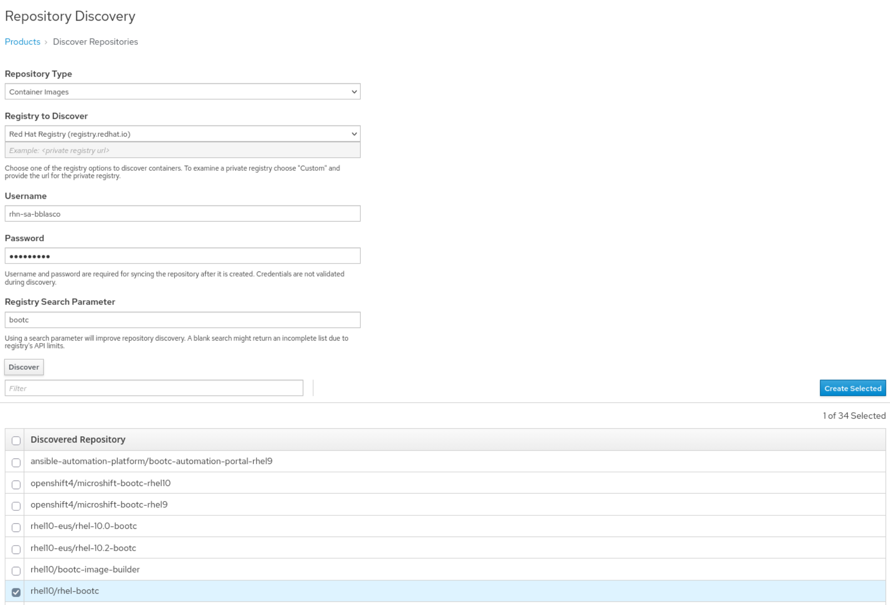
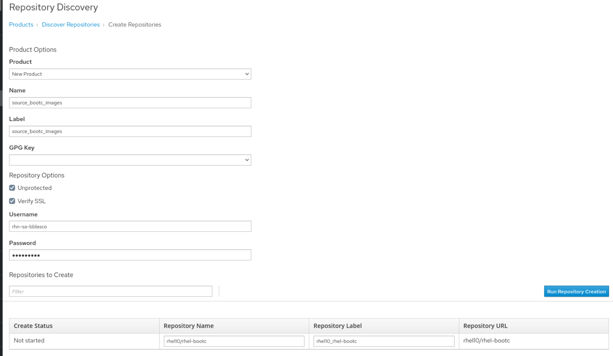
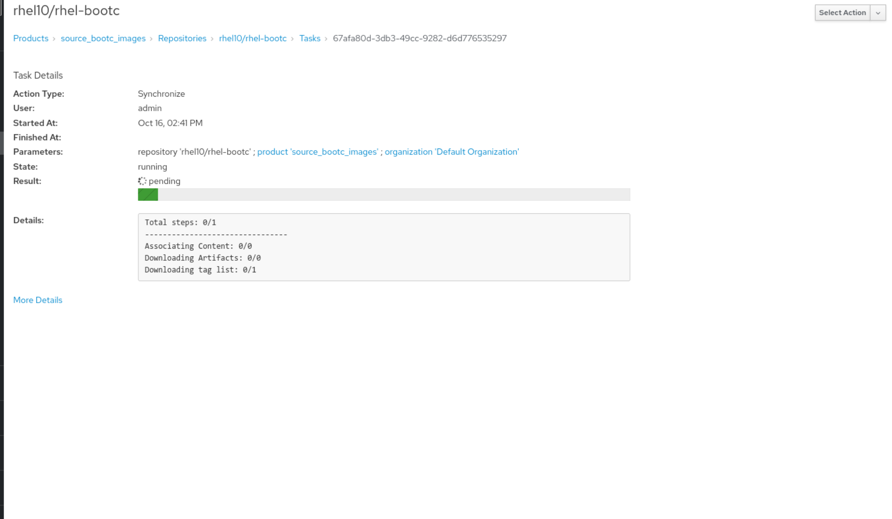
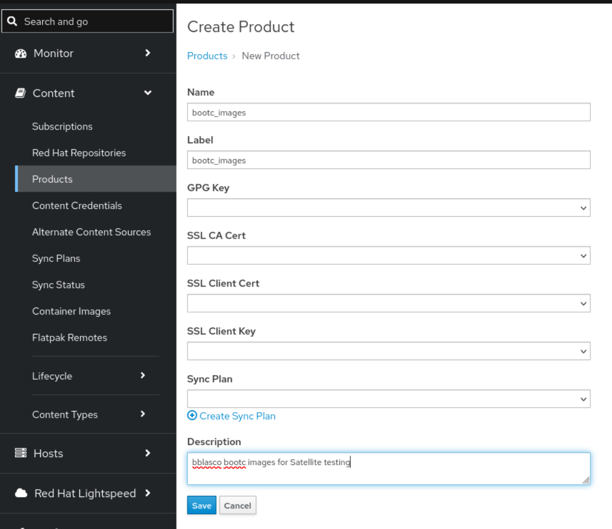
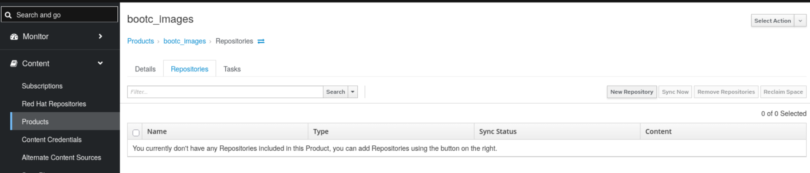
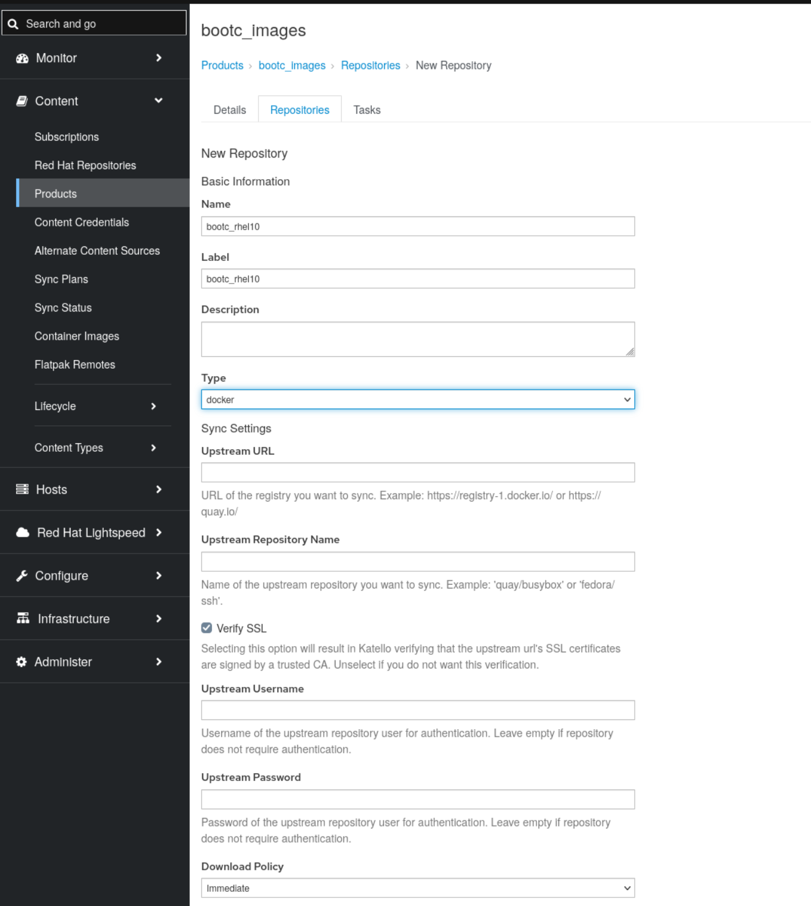
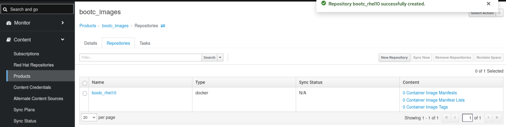
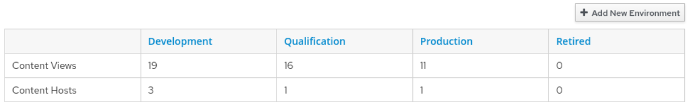
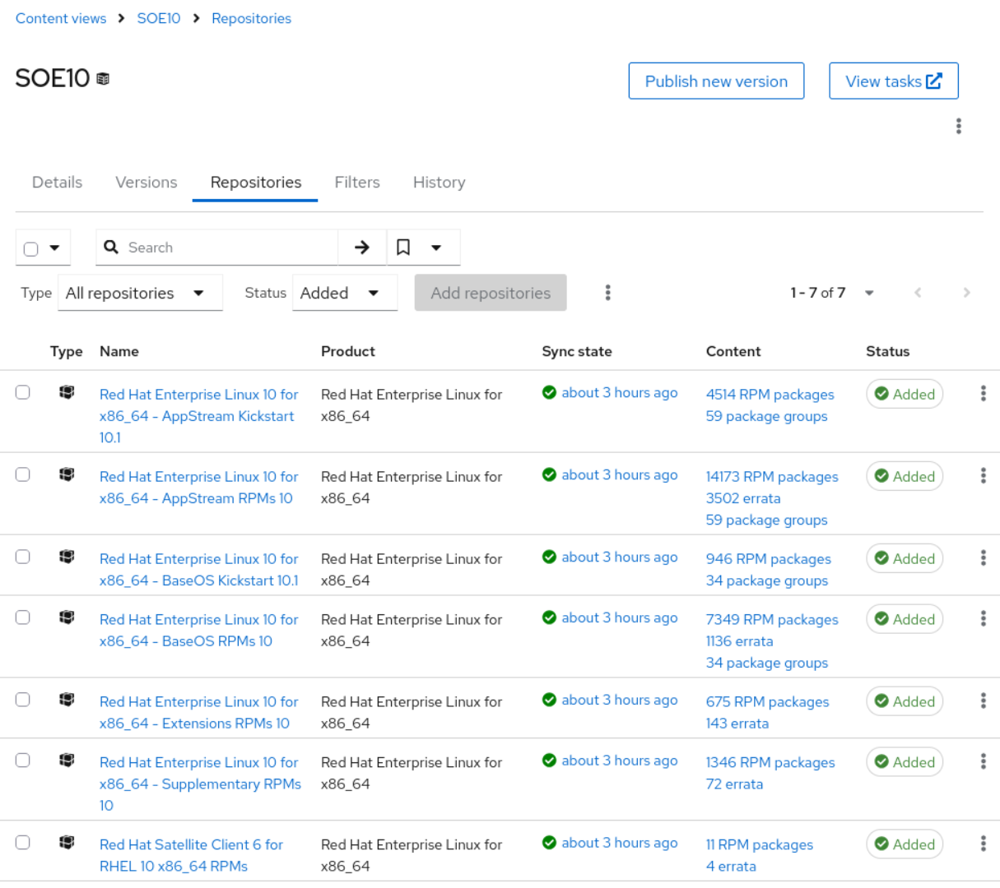
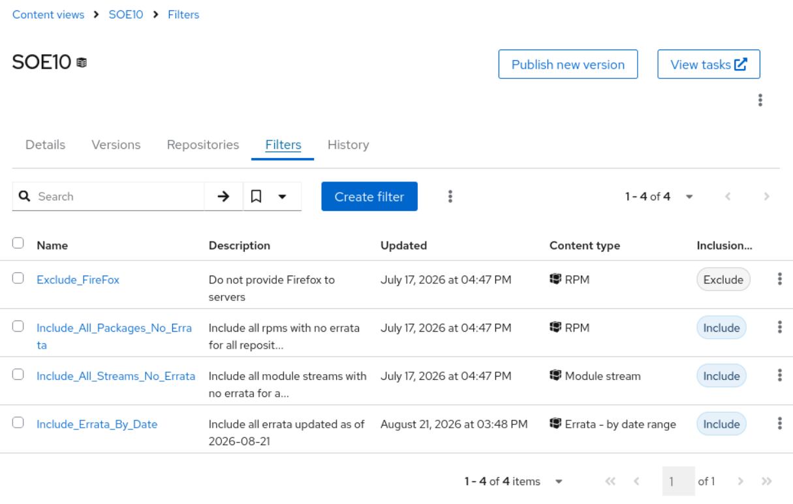

# Environment setup for bootc image building and hosting

Satellite can be used to create and manage the build environment, as well as hosting build artifacts.

The process to follow is:

1. Sync the RHEL 10 bootc registry from Red Hat to Satellite
2. Create a registry within Satellite to host the built images
3. Deploy and configure a build host

Once the above is complete, the image builds can commence; see [README-build-image.md](README-build-image.md).

---

## Sync the RHEL 10 bootc registry from RH

This step is not strictly mandatory if a build host has internet access to pull directly from [registry.redhat.io](registry.redhat.io), but it is good practice to control/curate content made available to hosts via Satellite.

1. Discover the RHEL 10 bootc base image repository via: Content -> Products -> Repo Discovery (button). This requires:
  - The Registry URL: `registry.redhat.io`
  - Red Hat Registry login credentials
  - Registry search parameter: `bootc`
  
2. Select the rhel10/rhel-bootc repository, and give the new repository a name e.g. `source_bootc_images`
  
3. Set the download policy: `On demand` (to save space), and sync the repo:
  

---

## Create a registry within Satellite to host the built images

1. Create a custom product: Products -> Create Product
  [3.6.1. Creating a custom product by using Satellite web UI](https://docs.redhat.com/en/documentation/red_hat_satellite/6.19/html/managing_content/adding-content-to-satellite#creating-a-custom-product-by-using-web-ui)  
  Name it `bootc_images`:
  
  The newly created product will not have any repositories:
  
  Create a repository called `bootc_rhel10`:
  
  The `bootc_rhel10` repository will now exist under the `bootc_images` product.
  
  Images in this repository will be named `satellite1.savage.test/bootc_images/bootc_rhel10`

---

## Deploy and configure a build host

The build host is used to build the customised bootc images and push them to the registry in Satellite.

The steps are:

1. Create a Lifecycle Environment (LCE) (path) and Content View (CV) to be used by the build host and control the content in the bootc images that will be built.
2. Deploy a build host within that LCE
3. Install the tools required for the build on the build host
4. Configure the build host to trust Satellite and authenticate to its container registry

---

## Create a Lifecycle Environment (LCE) (path) and Content View (CV) for the build host

Note: This section is very brief as it is following normal procedures for managing package mode hosts in Satellite.

1. Create a LCE for the build environment.
  It is only necessary to create a single build environment unless historical builds need to be reproduced for some reason (which I can't think of at the time of writing). The example below is using the existing SOE10 `Development` environment. The `Qualification` and `Production` environments are redundant in this context.  
  

2. Create a CV for the build environment.
  The CV must contain:
  - RHEL and other repositories hosting all content required by the build host
  - RHEL kickstart repositories used to deploy the build host
  - Any other repositories containing content that will be added to the bootc images being built. Below is my example SOE10 CV along with the filters in use.
  Note: Neither the bootc base image repository, nor the built image repository are included in the CV (Why?). The build host can still pull those container images from Satellite’s registry when building; that access is separate from RPM content in the CV (details to be documented further).
  
  

---

## Deploy a build host within that LCE

Deploy a build host using Satellite's kickstart-based provisioning procedure into the environment of your choice.

---

## Install the tools required for the build

The build host requires a set of container tools (which include podman, buildah, and skopeo) to be able to build images. These can be installed via the `container-tools` meta package.

```bash
sudo dnf install -y container-tools
```

Note: The versions of the packages installed will be in line with what is made available by the version of the CV currently associated with the host.

---

## Configure the build host to trust Satellite and the container registry

Complete these steps on the build host before following [README-build-image.md](README-build-image.md).

### Trust Satellite (TLS)

Download the certificate from your Satellite server's public folder and update the build host's trusted certificate store:

```bash
sudo -i
curl -o /etc/pki/ca-trust/source/anchors/katello-server-ca.crt \
  http://satellite1.savage.test/pub/katello-server-ca.crt
update-ca-trust
```

On a new build host, use the `http://.../pub/katello-server-ca.crt` URL for the first fetch (no TLS validation yet). After the CA is in `anchors` and `update-ca-trust` has run, you can verify with `curl -o /dev/null https://satellite1.savage.test/pub/katello-server-ca.crt` without `-k`.

### Registry authentication

Create a file called `containers-auth.json` in your build directory (and reuse it when building the image) with the base64 encoding of `username:password` for Satellite's registry. Use a placeholder in examples only—do not commit real credentials.

Example (credentials are illustrative):

```json
{
  "auths": {
    "satellite1.savage.test": {
      "auth": "bXl1c2VyOm15cGFzc3dvcmQ="
    }
  }
}
```

Generate the `auth` value:

```bash
echo -n "myuser:mypassword" | base64
```

Registry image paths use your organization's **label** (for example `default_organization` in `satellite1.savage.test/default_organization/...`). In Satellite: **Administer → Organizations →** *your org* **→ Label**.
