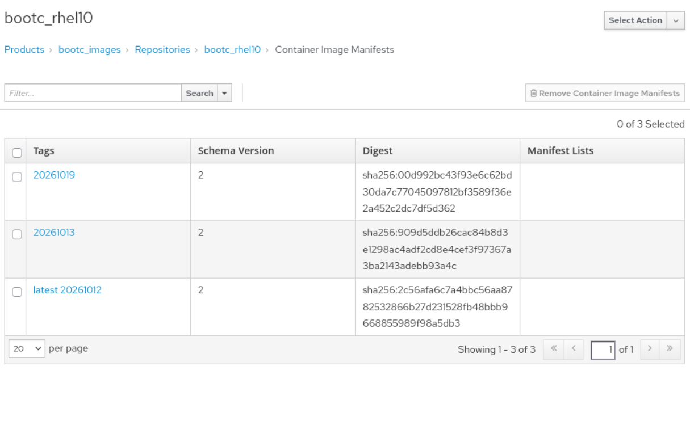

# Build the customised bootc container image

Once the environment setup is completed, the bootc image builds can take place.

All actions outlined below take place on the _build host_.

## Ensure the build hosts trusts Satellite

ie. Ensure System Trust for Satellite (SSL)

1. Download the certificate from your Satellite server's public folder and update the build host's trusted certificate store:
  ```
  sudo -i
  curl -k https://satellite1.savage.test -o /etc/pki/ca-trust/source/anchors/katello-server-ca.crt
  update-ca-trust
  ```

2. Enable the build host to download from Satellite's container registry.
   Create a file called `containers-auth.json` with the base64 encoding of the user:password for the Satellite server's registry.
  Example
  ```
  root@dbdev01:~# cat containers-auth.json

  {
       "auths": {
               "satellite1.savage.test": {
                       "auth": "YWRtaW46ZXlKaGJHY2lPaUpJVXo="
               }
       }
  }
  root@dbdev01:~#
  ```

  Note: The command to generate the base64 encoding of the user name and password is:
  ```
  root@dbdev01:~# echo -n "myuser:mypassword" | base64
  bXl1c2VyOm15cGFzc3dvcmQ=
  root@dbdev01:~# 
  ```


3. Create a Containerfile

The most important part here is that the bootc base image needs to be _older_ than the content available in the build host's CV, otherwise the resultat image's content cannot be guaranteed to align with what was madew available in the CV. This is relatively easy if the CV has a date filter. 

  Example Containerfile:
  ```
  FROM satellite1.savage.test/default_organization/source_bootc_images/rhel10_rhel-bootc:10.2-1791784396
  #FROM registry.redhat.io/rhel10/rhel-bootc:1784790803
  
  ###############################################
  # From Waldirio Pinheiro video
  #  Setting Up Bootc with Red Hat Satellite: A Guide to Bootable Container Images 
  # https://www.youtube.com/watch?v=7d8DqlDuwJU
  
  # Satellite certificate so that bootc instances can trust Satellite
  # Retrieve the certificate via:
  # wget http://satellite1.savage.test/pub/katello-server-ca.crt
  # or 
  # curl http://satellite1.savage.test/pub/katello-server-ca.crt -o katello-server-ca.crt
  COPY katello-server-ca.crt /etc/pki/ca-trust/source/anchors
  RUN update-ca-trust
  
  # This is the credential to authenticate to Satellite's registry (assuming it is a closed registry)
  # Waldirio says the documentation on this is poor and he filed some docs issues. Not sure if fixed yet
  # Retrieve the auth file via:
  # cp ${XDG_RUNTIME_DIR}/containers/auth.json containers-auth.json
  # or
  # podman login satellite1.savage.test --authfile containers-auth.json
  COPY containers-auth.json /etc/ostree/auth.json
  
  ###############################################
  # Make sure we use the right Satellite repos
  # Optional: Remove default repos if replacing them entirely
  RUN rm -f /etc/yum.repos.d/*.repo
  
  # Copy your custom repo file into the container
  #COPY etc/yum.repos.d/redhat.repo /etc/yum.repos.d/redhat.repo
  #COPY etc/yum.repos.d/redhat.repo /run/secrets/redhat.repo
  #RUN grep savage /etc/yum.repos.d/redhat.repo
  RUN cat /run/secrets/redhat.repo
  
  RUN <<EOF
      set -euo pipefail
          dnf install -y httpd firewalld openssh-server bash-completion tmux rhc-worker-playbook
          #dnf install -y httpd openssh-server bash-completion tmux rhc-worker-playbook
          dnf update -y --exclude="kernel*" --setopt="install_weak_deps=false"
          dnf clean all
  EOF
  
  RUN mkdir -p /root/.ssh && chmod 700 /root/.ssh
  COPY id_rsa.pub /root/.ssh/authorized_keys
  RUN chmod 600 /root/.ssh/authorized_keys
  
  RUN systemctl enable httpd
  #RUN systemctl enable firewalld

  # Set the timezone
  RUN ln -s /usr/share/zoneinfo/Australia/Melbourne /etc/localtime

  # Lint the container image
  RUN bootc container lint
  ```
  
  4. Build the container image
  ```
  podman build -t satellite1.savage.test/default_organization/bootc_images/bootc_rhel10:20261019 .
  ```

  5. Push to the container registry
  [14.3.4. Pushing container images to Satellite](https://docs.redhat.com/en/documentation/red_hat_satellite/6.19/html/managing_content/managing_container_images_content-management#pushing-container-images-to-satellite)

  ```
  # podman push My_Container_Image_ID satellite.example.com/My_Organization_Label/My_Product_Label/My_Repository_Name[:My_Tag]
  podman push satellite1.savage.test/default_organization/bootc_images/bootc_rhel10:20261019 .
  ```

   6. Check that the image is visible in the container registry on Satellite
   Products -> bootc_images (repository) -> bootc_rhel10 (image) -> Container image manifests
 
  
