# Deploy a bootc-based VM using Satellite

A reminder: Much of the background and concept came from Ian Ballou's great article: [Provisioning image mode for RHEL using Satellite](https://developers.redhat.com/articles/2026/08/06/image-mode-for-rhel-with-anaconda-and-satellite).

Once a bootc container image has been pushed to Satellite's registry, it becomes possible to deploy new instances using Satellite's provisioning capabilities. 

The instructions below use network provisioning and the Anaconda Installer's kickstart capability to deploy VMs that pull the bootc image from Satellite's registry and lay it down on disk.

The high level steps to enable deployment of bootc-based VMs are:

1. Create a lifecycle environment (path) for the VMs
2. Create a content view to allow network provisioning and access to the right container image(s)
3. Create the bootc-specific provisioning kickstart template
4. Create an activation key
5. Create a host group to pull all the required configurations together
6. Add custom parameters to the host group
7. Provision a new bootc VM

---


## Provisioning flow overview

Network provisioning chains several Foreman **template kinds**. Only the **provision** kickstart is customized for bootc; PXE boot still uses the operating system's default **SOE Kickstart Default PXELinux** template.

End-to-end flow:

1. Host PXE-boots; **PXELinux** supplies kernel/initrd, `inst.ks`, static IP, and `inst.stage2` (kickstart install tree).
2. Anaconda downloads and runs the rendered `kickstart_bootc_rhel10` provision template.
3. `ostreecontainer` pulls the  bootc image from the Satellite container registry and deploys to disk.
4. `%post` registers the host (subscription-manager / Satellite snippets), installs remote-execution keys, and POSTs to Foreman `/unattended/built` (or `failed`).

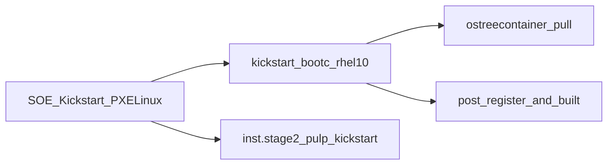


---


## Create a lifecycle environment path for the bootc hosts


## Create a content view for the deployed bootc hosts. The CV requires access to the container repository with the bootc container images, and a RHEL 10 Kickstart baseos repo so that new hosts can be built from a kickstart.

1. Create the content view
  
2. Add the repositories:
  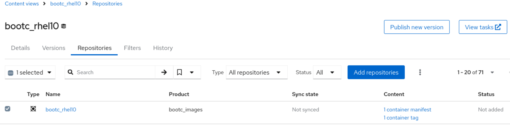
  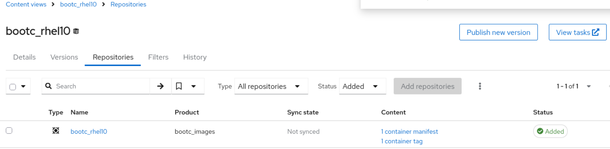
3. Create a filter on a tag or tags for the container images.
  Optionally (but not shown here) you can also create filters on the kickstart repository as per regular package mode practices.
  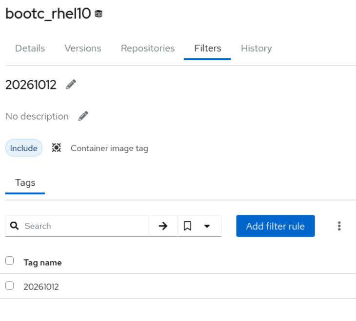

---


## Create a bootc-specific kickstart template

The example kickstart template in this repository, which can be found [here](files/kickstart_bootc_rhel10.ks), is a very lightly modified version of the template provided in the previously linked article [Provisioning image mode for RHEL using Satellite](https://developers.redhat.com/articles/2026/08/06/image-mode-for-rhel-with-anaconda-and-satellite).

The key differences are:

- It allows pulling from a container registry that requires authentication
- It is configured so that the authentication details are only used in the template if the base64 encoded `username:password` string is passed as the `bootc_registry_auth_b64` parameter (see instructions later in this guide)

1. Add the template via Hosts -> Templates -> Provisioning Templates:
  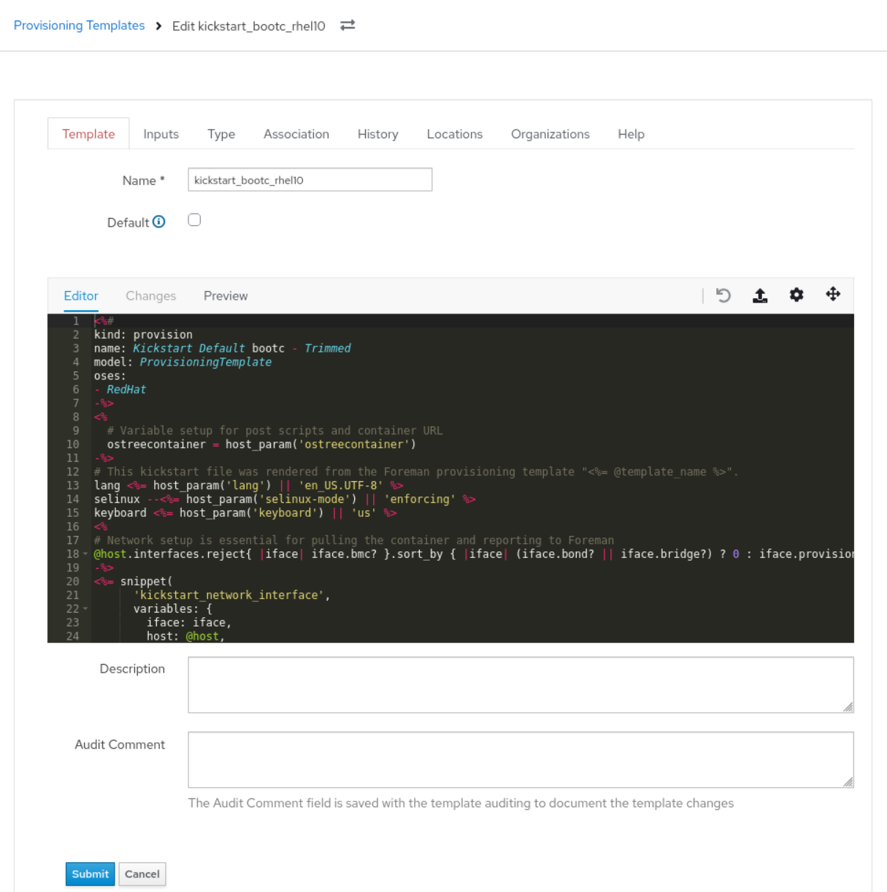
2. Assign it to the relevant Operating Systems (10.0/10.1/10.2 in this case):
  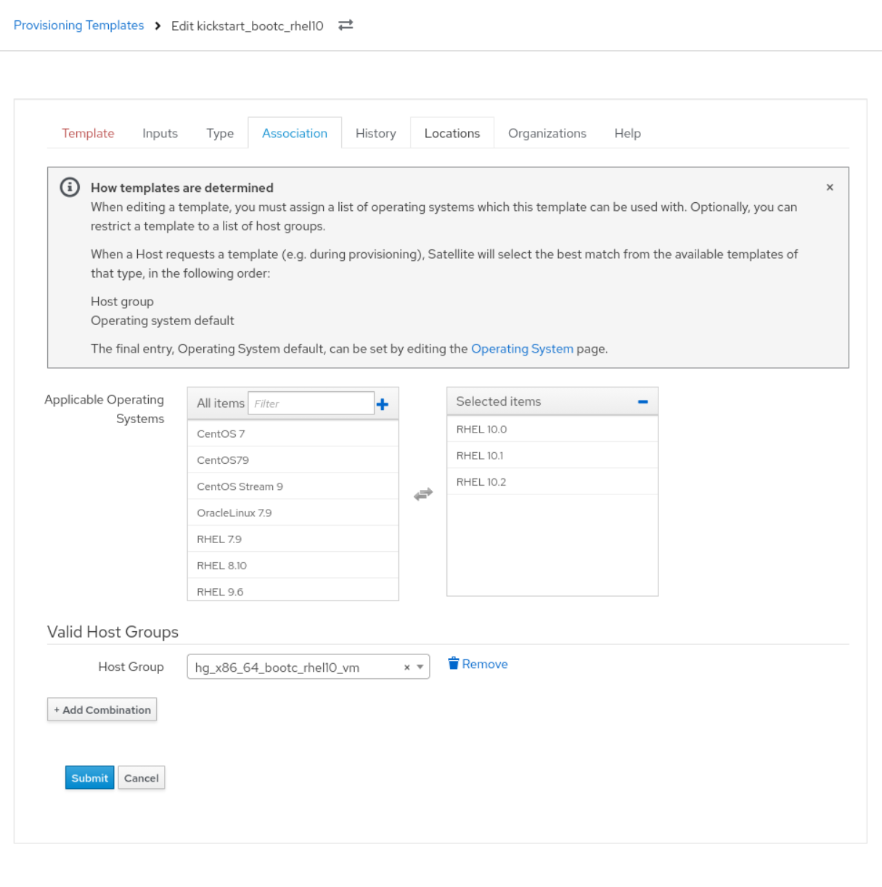

PXE templates (**SOE Kickstart Default PXELinux**, etc.) remain the OS defaults; that is expected.

### Template behavior (summary)


| Area         | Behavior                                                                                          |
| ------------ | ------------------------------------------------------------------------------------------------- |
| Network      | `kickstart_network_interface` snippet per interface                                               |
| Pre-install  | Conditional `%pre` when `bootc_registry_auth_b64` is set (TLS + auth)                             |
| Image source | `ostreecontainer --url <%= ostreecontainer %>`                                                    |
| Partitioning | `@host.diskLayout` (Kickstart default thin from host group)                                       |
| Installer UI | `text` and `skipx`                                                                                |
| Post-install | `redhat_register`, `remote_execution_ssh_keys`, Foreman `built` / `failed` via `install.post.log` |

## Create the activation key

1. Navigate to Content -> Lifecycle -> Activation Keys and create an activation key with the following settings:
  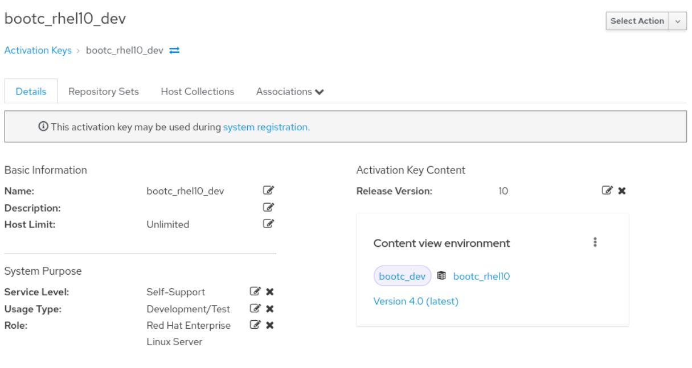
  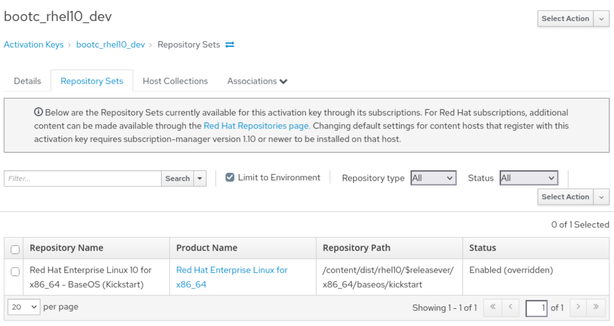

## Create the host group

Use host group `hg_x86_64_bootc_rhel10_vm` as the entry point for all bootc libvirt VMs.

1. Create the host group via Configure -> Host Groups with the following parameters:

Host group values
| Setting                    | Value                                                                                                         |
| -------------------------- | ------------------------------------------------------------------------------------------------------------- |
| Organization / location    | Default Organization / Default Location                                                                       |
| Compute resource           | `nuc` (libvirt)                                                                                               |
| Operating system           | RHEL 10.0 / 10.1 / 10.2) |
| Lifecycle environment      | `bootc_dev`                                                                                                   |
| Content view               | `bootc_rhel10`                                                                                                |
| Kickstart repository       | Red Hat Enterprise Linux 10 for x86_64 - BaseOS Kickstart **10.1** (repo id **911**)                          |
| Partition table            | Kickstart default thin (id **150**)                                                                           |
| PXE loader                 | PXELinux UEFI                                                                                                 |
| Provision template (combo) | `kickstart_bootc_rhel10` (id **289**)                                                                         |

  Container image (registry) URI
| Item           | Value                                                                                                           |
| -------------- | --------------------------------------------------------------------------------------------------------------- |
| Product        | `bootc_images`                                                                                                  |
| Repository     | `bootc_rhel10` (docker / container, repo id **901**)                                                            |
| Published path | `satellite1.savage.test/default_organization/bootc_images/bootc_rhel10`                                         |
| Image tag      | Set on host group parameter `ostreecontainer` (e.g. `20261019`); update when you promote a new tag in Satellite |

  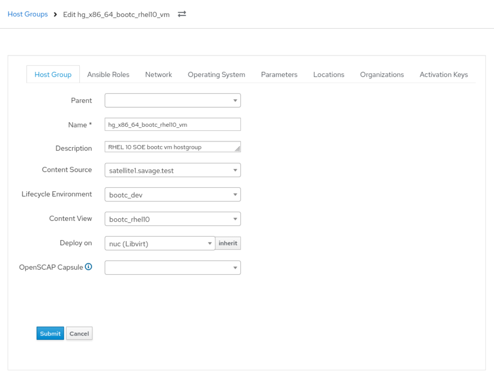
  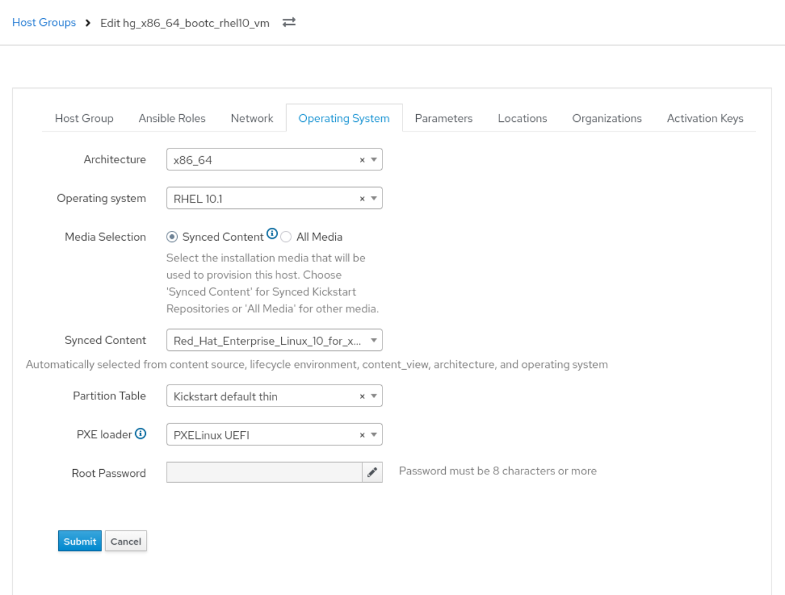
  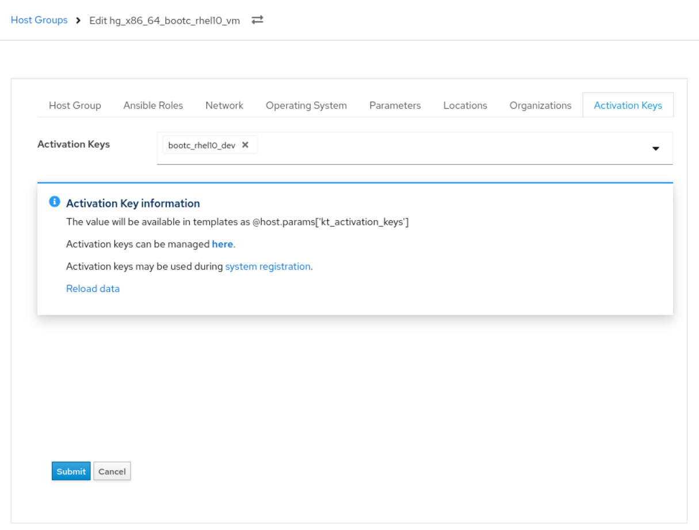

Note: The kickstart and container content must be **synced** and the content view **promoted** to `bootc_dev` before provisioning.

### Infrastructure assumptions

- Satellite provides **managed DHCP, DNS, and TFTP** for the provisioning subnet.
- Per-host PXE config is deployed under `/var/lib/tftpboot/pxelinux.cfg/` (e.g. `01-<mac-with-dashes>`).
- Provisioning network: `savage.test` (example DNS `192.168.140.5`, gateway `192.168.140.1`).

## Add custom parameters to the host group

These parameters are injected into the kickstart to fit this particular environment.

1. Configure the following on **Hosts → Host groups →** `hg_x86_64_bootc_rhel10_vm` **→ Parameters** (ie the same host group as the previous step):

| Parameter                         | Type   | Purpose                                                                                                                                                                               |
| --------------------------------- | ------ | ------------------------------------------------------------------------------------------------------------------------------------------------------------------------------------- |
| `ostreecontainer`                 | string | Container image reference for `ostreecontainer --url` — **plain reference, no** `docker://` **prefix**: `satellite1.savage.test/default_organization/bootc_images/bootc_rhel10:<tag>` |
| `kickstart_kernel_custom_options` | json   | Kernel options appended by PXE templates; must include `inst.stage2` pointing at the kickstart tree in **your** CV/LE (not Library). Example below.                                   |
| `bootc_registry_auth_b64`         | string | Base64-encoded `username:password` for Satellite registry login during install; enables `%pre` in kickstart. Mark as **Hidden value** in the UI.                                      |
| `kt_activation_keys`              | string | `bootc_rhel10_dev`                                                                                                                                                                    |
| `boot_disk`                       | string | `/dev/vda`                                                                                                                                                                            |

  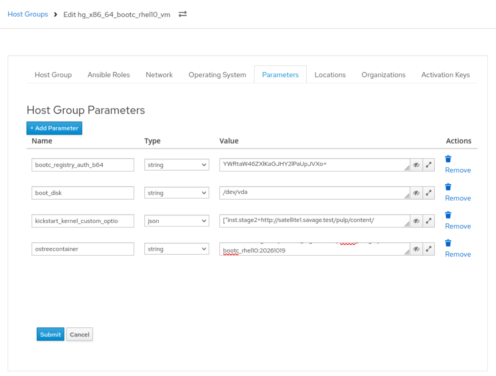


### `kickstart_kernel_custom_options` (working example)

```json
["inst.stage2=http://satellite1.savage.test/pulp/content/Default_Organization/bootc_dev/bootc_rhel10/content/dist/rhel10/10.1/x86_64/baseos/kickstart/"]
```

Derive this URL from the kickstart repository's pulp path in Satellite (**Content → Lifecycle Environments → bootc_dev → bootc_rhel10**), or from the repository **Published at** / download URL for the BaseOS kickstart repo in that CV. The path must include `bootc_dev/bootc_rhel10`, not `Library`.

### Registry authentication (`bootc_registry_auth_b64`)

Generate the value on a trusted machine (do not commit real credentials to git):

```bash
echo -n 'SATELLITE_USER:SATELLITE_PASSWORD' | base64 -w0
```

Paste the output into the host group parameter and enable **Hidden value**.

Pre-flight from a host that trusts the Satellite CA:

```bash
podman login satellite1.savage.test
podman pull satellite1.savage.test/default_organization/bootc_images/bootc_rhel10:<tag>
```

Use the same user/password and image reference as in the host group parameters.

---


## Global and related settings


| Setting                   | Value / notes                                                                                          |
| ------------------------- | ------------------------------------------------------------------------------------------------------ |
| `use_graphical_installer` | Global parameter `false` — text installer; affects what you see on VNC during install                  |
| Synced content            | RHEL 10 BaseOS kickstart + `bootc_rhel10` container repo in CV `bootc_rhel10`, promoted to `bootc_dev` |
| Activation key            | `bootc_rhel10_dev` (via `kt_activation_keys`)                                                          |


---

## Provisioning a new bootc VM

1. Navigate to **Hosts → Create host**:
  
  
  
  

1. **Hosts → Create host** (or bulk): assign `hg_x86_64_bootc_rhel10_vm`, libvirt on **nuc**, synced kickstart media, content view `bootc_rhel10` / LE `bootc_dev`, enable **Build**.
2. **Verify rendered kickstart:** host **Templates** tab, or from Satellite:
  `GET /unattended/provision?static=1&token=<host-token>`  
   Confirm: `ostreecontainer --url`, optional `%pre`, network stanza, no `url`/`repo` for install source.
3. **Verify PXE:** on Satellite, inspect
  `/var/lib/tftpboot/pxelinux.cfg/01-<mac>`  
   **APPEND** should include `inst.ks=...` and `inst.stage2=...bootc_dev/bootc_rhel10...`.
4. Power on / build; wait for install to finish.
5. **On the guest:** `bootc status` — booted image should match `ostreecontainer`.
6. **In Foreman:** build flag clears after successful `/unattended/built` callback.

---


## Accessing install consoles (VNC and limits)

Install runs on hypervisor **nuc** (`nuc.lan`). During install the kickstart uses `text` + `skipx`, so the Satellite **Console** tab and default VNC view are often **blank or minimal** until Anaconda prints errors or progress text.


| Method                     | How                                                                                                                                                |
| -------------------------- | -------------------------------------------------------------------------------------------------------------------------------------------------- |
| Satellite UI               | Host → **Console**                                                                                                                                 |
| VNC display                | On nuc: `sudo virsh vncdisplay <fqdn.savage.test>` → e.g. `:4` means TCP port **5904** (`5900 + display number`). Client: `nuc.lan:5904`           |
| VNC password               | On nuc: `sudo virsh dumpxml --security-info <fqdn>` (VNC password may not appear in saved domain XML without security info)                        |
| Post-install script output | Template runs `%post` with `exec < /dev/tty3` and `chvt 3` — useful text may be on **virtual console 3**; switch VT in the VNC client if supported |
| Serial console             | `sudo virsh console <fqdn>` — usually **no output** unless `console=ttyS0` (or similar) is added to PXE kernel options                             |
| Screenshot (no VNC client) | On nuc: `sudo virsh screenshot <fqdn> /tmp/frame.ppm`                                                                                              |


A blank VNC screen during early dracut or quiet install is **normal**. Use screenshot or scroll the text UI when Anaconda shows errors.

---


## Verification and maintenance

- `ostreecontainer`**:** Update the image **tag** on the host group when you publish and promote a new bootc tag in Satellite.
- `inst.stage2`**:** If lifecycle environment, content view, or kickstart repo version changes, update `kickstart_kernel_custom_options` to match the new pulp kickstart path.
- **OS minor version:** Host may be registered as RHEL 10.2 while `inst.stage2` points at the **10.1** kickstart tree in the CV; keep the stage2 URL aligned with the kickstart repo actually in `bootc_dev/bootc_rhel10`.
- **Registry:** After changing Satellite registry credentials, regenerate `bootc_registry_auth_b64` and mark the parameter hidden.

---


## Quick reference


| Object             | Name / id                        |
| ------------------ | -------------------------------- |
| Host group         | `hg_x86_64_bootc_rhel10_vm` (34) |
| Provision template | `kickstart_bootc_rhel10` (289)   |
| PXE (OS default)   | SOE Kickstart Default PXELinux   |
| Container repo     | `bootc_rhel10` (901)             |
| Kickstart repo     | BaseOS Kickstart 10.1 (911)      |
| Satellite          | `satellite1.savage.test`         |
| Hypervisor         | `nuc`                            |


