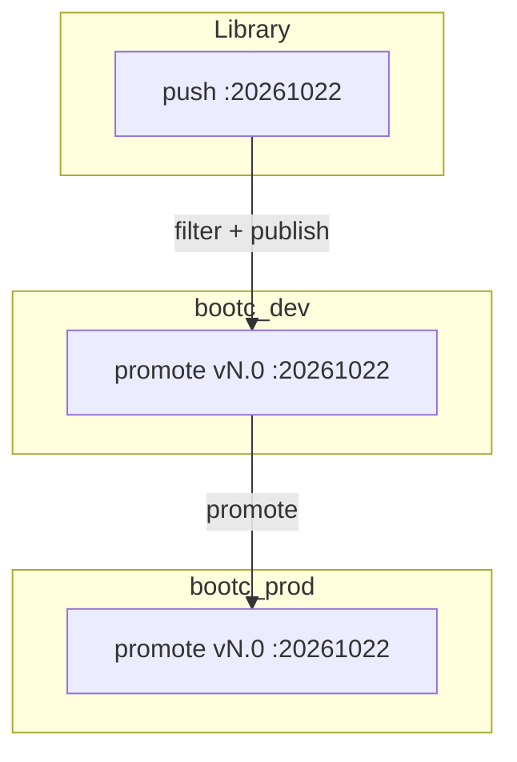
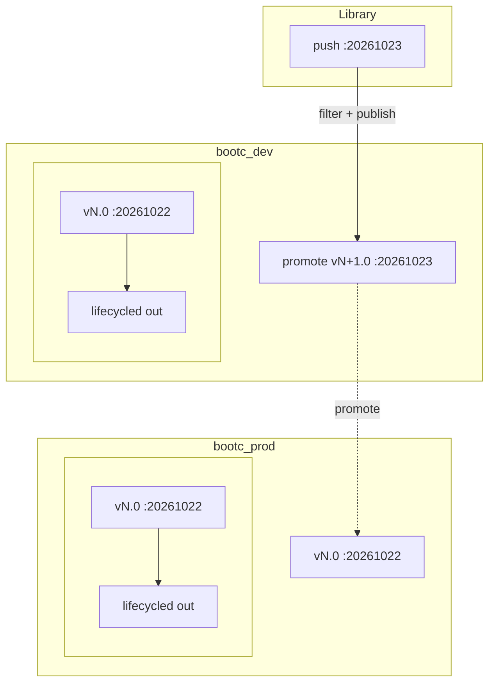

# Bootc image lifecycle (dev → prod)

Tag-filtered promotion of custom bootc images from **Library** into deploy lifecycle environments **`bootc_dev`** and **`bootc_prod`**, using deploy content view **`bootc_rhel10`** and container repository **`bootc_images` / `bootc_rhel10`**. Build and push: [README.build-image.md](README.build-image.md). Host provisioning: [README.deploy-host.md](README.deploy-host.md).

## Immutable tags

- Assign a **new tag per build** (e.g. `20261022`, `20261023`); do not reuse or overwrite tags in Library.
- The tag is the **release identity** for test sign-off and prod rollout.
- The deploy CV **container image tag filter** decides which tags are captured in each **published** version.

## New build in dev

1. `podman push` the image to Library; **sync** the `bootc_rhel10` container repository if the tag is not visible yet.
2. Update the deploy CV filter to **include** the new tag.
3. **Publish** a new content view version.
4. **Promote** that version to **`bootc_dev` only**.

Prod changes only when a content view version **that contains the chosen tag** is **promoted to `bootc_prod`**; `bootc_dev` can run a newer version while prod stays on an older one.

## Publish and promote cycle

### First tag (`20261022`)

### Next tag (`20261023`) with `:20261022` already in dev and prod

Prod keeps **vN.0** (`:20261022`) until you **filter + publish** and **promote** a version that includes `:20261023` to **`bootc_prod`**.

## Reminders

- Registry references for pull/provision: **Content → Container image tags** (pullable paths per LCE/CV). Step-by-step: [README.deploy-host.md — Publish and promote container images via image tags](README.deploy-host.md#publish-and-promote-container-images-via-image-tags).
- If promotion to multiple LCEs in one action breaks pulls, **promote to each LCE separately** and recheck pullable paths.
