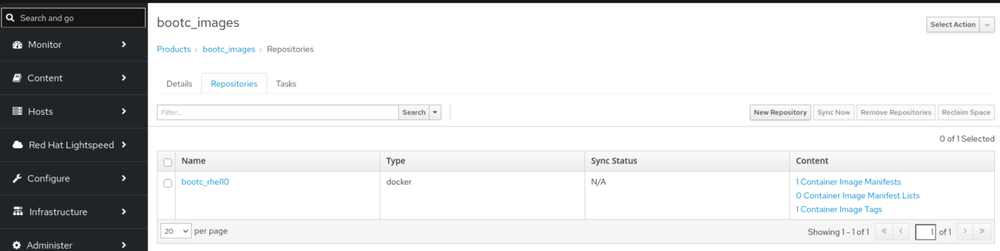
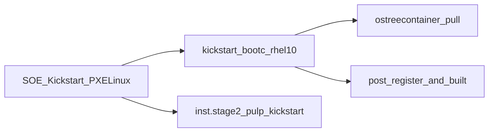

# Satellite bootc (image mode) provisioning

Internal runbook for provisioning **RHEL image mode (bootc)** VMs with **Red Hat Satellite** (`satellite1.savage.test`), **Anaconda kickstart**, and the **nuc** libvirt compute resource on `savage.test`.

Background and concepts: [Provisioning image mode for RHEL using Satellite](https://developers.redhat.com/articles/2026/08/06/image-mode-for-rhel-with-anaconda-and-satellite).

**Validated in this lab:** `fail07.savage.test` completed build and booted successfully using the configuration below.

---

## Setup

The provisioning steps later in this document assume bootc content is available on Satellite: a synced upstream bootc registry (optional source material) and a custom image pushed to the Satellite container registry and exposed through a content view. The following subsections are imported from the Joplin note *Image Builder for Image mode hosts using satellite* (**Sync the RHEL 10 bootc registry from RH** and **Push to Satellite registry**).


### Push the built image to Satellite

1. Push the built image to Satellite

[14.3.4. Pushing container images to Satellite](https://docs.redhat.com/en/documentation/red_hat_satellite/6.19/html/managing_content/managing_container_images_content-management#pushing-container-images-to-satellite)

```
podman login satellite1.savage.test
podman push satellite1.savage.test/rhel-bootc-from-sat:latest
```

That's not a valid name/tag, so you need to address this error:

```
WARN[0040] Failed, retrying in 1s ... (2/3). Error: writing blob: initiating layer upload to /v2/rhel-bootc-from-sat/blobs/uploads/ in satellite1.savage.test: name invalid: Invalid format. Container pushes should follow 'organization_label/product_label/name' OR 'id/organization_id/product_id/name' schema.
```

Label based push:

```
# podman push My_Container_Image_ID satellite.example.com/My_Organization_Label/My_Product_Label/My_Repository_Name[:My_Tag]
podman push localhost/rhel-bootc-from-sat:latest docker://satellite1.savage.test/default_organization/bootc_images/bootc_rhel10:latest
```

Then the registry and image appear:



1. Create a content view for the deployed bootc hosts. ~~Note that the screenshots below only include the container repo in the Satellite registry.~~ The CV also requires a RHEL 10 Kickstart baseos repo to be added so that new hosts can be built from a kickstart.  


  Add the repositories:  
  


Create a filter on a tag or tags for the container images. Optionally you can also create filters on the kickstart repository as per regular package mode practices.


1. Create a lifecycle environment path for the bootc hosts  


---

## Overview

Network provisioning chains several Foreman **template kinds**. Only the **provision** kickstart is customized for bootc; PXE boot still uses the operating system's default **SOE Kickstart Default PXELinux** template.

End-to-end flow:

1. Host PXE-boots; **PXELinux** supplies kernel/initrd, `inst.ks`, static IP, and **`inst.stage2`** (kickstart install tree).
2. Anaconda downloads and runs the rendered **`kickstart_bootc_rhel10`** provision template.
3. **`ostreecontainer`** pulls the bootc image from the Satellite container registry and deploys to disk.
4. **`%post`** registers the host (subscription-manager / Satellite snippets), installs remote-execution keys, and POSTs to Foreman **`/unattended/built`** (or `failed`).




---

## Satellite content and host group

Use host group **`hg_x86_64_bootc_rhel10_vm`** (Foreman id **34**) as the entry point for all bootc libvirt VMs.


| Setting                    | Value                                                                                                         |
| -------------------------- | ------------------------------------------------------------------------------------------------------------- |
| Organization / location    | Default Organization / Default Location                                                                       |
| Compute resource           | `nuc` (libvirt)                                                                                               |
| Operating system           | RHEL **10.x** (e.g. **RHEL 10.2** on `fail07`; provision template is associated with RHEL 10.0 / 10.1 / 10.2) |
| Lifecycle environment      | `bootc_dev`                                                                                                   |
| Content view               | `bootc_rhel10`                                                                                                |
| Kickstart repository       | Red Hat Enterprise Linux 10 for x86_64 - BaseOS Kickstart **10.1** (repo id **911**)                          |
| Partition table            | Kickstart default thin (id **150**)                                                                           |
| PXE loader                 | PXELinux UEFI                                                                                                 |
| Provision template (combo) | **`kickstart_bootc_rhel10`** (id **289**)                                                                     |


### Container image (registry)


| Item           | Value                                                                                                           |
| -------------- | --------------------------------------------------------------------------------------------------------------- |
| Product        | `bootc_images`                                                                                                  |
| Repository     | `bootc_rhel10` (docker / container, repo id **901**)                                                            |
| Published path | `satellite1.savage.test/default_organization/bootc_images/bootc_rhel10`                                         |
| Image tag      | Set on host group parameter `ostreecontainer` (e.g. `20261019`); update when you promote a new tag in Satellite |


Kickstart and container content must be **synced** and the content view **promoted** to `bootc_dev` before provisioning.

### Infrastructure assumptions

- Satellite provides **managed DHCP, DNS, and TFTP** for the provisioning subnet.
- Per-host PXE config is deployed under `/var/lib/tftpboot/pxelinux.cfg/` (e.g. `01-<mac-with-dashes>`).
- Provisioning network: `savage.test` (example DNS `192.168.140.5`, gateway `192.168.140.1`).

---

## Host group parameters

Configure on **Hosts → Host groups → `hg_x86_64_bootc_rhel10_vm` → Parameters**.


| Parameter                         | Type   | Purpose                                                                                                                                                                           |
| --------------------------------- | ------ | --------------------------------------------------------------------------------------------------------------------------------------------------------------------------------- |
| `ostreecontainer`                 | string | Container image reference for `ostreecontainer --url` — **plain reference, no `docker://` prefix**: `satellite1.savage.test/default_organization/bootc_images/bootc_rhel10:<tag>` |
| `kickstart_kernel_custom_options` | json   | Kernel options appended by PXE templates; must include **`inst.stage2`** pointing at the kickstart tree in **your** CV/LE (not Library). Example below.                           |
| `bootc_registry_auth_b64`         | string | Base64-encoded `username:password` for Satellite registry login during install; enables `%pre` in kickstart. Mark as **Hidden value** in the UI.                                  |
| `kt_activation_keys`              | string | `bootc_rhel10_dev`                                                                                                                                                                |
| `boot_disk`                       | string | `/dev/vda`                                                                                                                                                                        |


### `kickstart_kernel_custom_options` (working example)

```json
["inst.stage2=http://satellite1.savage.test/pulp/content/Default_Organization/bootc_dev/bootc_rhel10/content/dist/rhel10/10.1/x86_64/baseos/kickstart/"]
```

Derive this URL from the kickstart repository's pulp path in Satellite (**Content → Lifecycle Environments → bootc_dev → bootc_rhel10**), or from the repository **Published at** / download URL for the BaseOS kickstart repo in that CV. The path must include **`bootc_dev/bootc_rhel10`**, not `Library`.

### Registry authentication (`bootc_registry_auth_b64`)

Generate the value on a trusted machine (do not commit real credentials to git):

```bash
echo -n 'SATELLITE_USER:SATELLITE_PASSWORD' | base64 -w0
```

Paste the output into the host group parameter and enable **Hidden value**.

Pre-flight from a host that trusts the Satellite CA:

```bash
podman login satellite1.savage.test
podman pull satellite1.savage.test/default_organization/bootc_images/bootc_rhel10:<tag>
```

Use the same user/password and image reference as in the host group parameters.

---

## Kickstart template: `kickstart_bootc_rhel10`

### Create and associate

1. **Hosts → Templates → Provisioning templates → Create template**
2. **Name:** `kickstart_bootc_rhel10`
3. **Template type:** Provision
4. Body: trimmed bootc kickstart from the Red Hat article (no `url` / `repo` kickstart commands; uses `ostreecontainer`).
5. **Associations:** Operating systems RHEL 10.0, 10.1, 10.2; organization and location.
6. **Host group:** Add a **template combination** on `hg_x86_64_bootc_rhel10_vm` so this template overrides the OS default **SOE Kickstart Default** for **provision** only.

PXE templates (**SOE Kickstart Default PXELinux**, etc.) remain the OS defaults; that is expected.

### Template behavior (summary)


| Area         | Behavior                                                                                          |
| ------------ | ------------------------------------------------------------------------------------------------- |
| Network      | `kickstart_network_interface` snippet per interface                                               |
| Pre-install  | Conditional `%pre` when `bootc_registry_auth_b64` is set (TLS + auth)                             |
| Image source | `ostreecontainer --url <%= ostreecontainer %>`                                                    |
| Partitioning | `@host.diskLayout` (Kickstart default thin from host group)                                       |
| Installer UI | `text` and `skipx`                                                                                |
| Post-install | `redhat_register`, `remote_execution_ssh_keys`, Foreman `built` / `failed` via `install.post.log` |


### Conditional `%pre` block (registry TLS + auth)

Insert after network lines and **before** `ostreecontainer`. In the Satellite template editor (ERB):

```erb
<% if host_param('bootc_registry_auth_b64').present? -%>
%pre --erroronfail
REGISTRY="satellite1.savage.test"
mkdir -p "/etc/containers/certs.d/${REGISTRY}"
curl -sf "http://${REGISTRY}/pub/katello-server-ca.crt" \
  -o "/etc/containers/certs.d/${REGISTRY}/ca.crt"
mkdir -p /etc/ostree
cat > /etc/ostree/auth.json << 'EOF'
{
  "auths": {
    "satellite1.savage.test": {
      "auth": "<%= host_param('bootc_registry_auth_b64') %>"
    }
  }
}
EOF
%end
<% end -%>
```

The full template (partitioning, `%post`, snippets) is maintained in Satellite as template id **289**.

---

## Global and related settings


| Setting                   | Value / notes                                                                                                  |
| ------------------------- | -------------------------------------------------------------------------------------------------------------- |
| `use_graphical_installer` | Global parameter **`false`** — text installer; affects what you see on VNC during install                      |
| Synced content            | RHEL 10 BaseOS kickstart + `bootc_rhel10` container repo in CV **`bootc_rhel10`**, promoted to **`bootc_dev`** |
| Activation key            | `bootc_rhel10_dev` (via `kt_activation_keys`)                                                                  |


---

## Provisioning a new bootc VM

1. **Hosts → Create host** (or bulk): assign **`hg_x86_64_bootc_rhel10_vm`**, libvirt on **nuc**, synced kickstart media, content view **`bootc_rhel10`** / LE **`bootc_dev`**, enable **Build**.
2. **Verify rendered kickstart:** host **Templates** tab, or from Satellite:
  `GET /unattended/provision?static=1&token=<host-token>`  
   Confirm: `ostreecontainer --url`, optional `%pre`, network stanza, no `url`/`repo` for install source.
3. **Verify PXE:** on Satellite, inspect
  `/var/lib/tftpboot/pxelinux.cfg/01-<mac>`  
   **APPEND** should include `inst.ks=...` and `inst.stage2=...bootc_dev/bootc_rhel10...`.
4. Power on / build; wait for install to finish.
5. **On the guest:** `bootc status` — booted image should match `ostreecontainer`.
6. **In Foreman:** build flag clears after successful **`/unattended/built`** callback.

---

## Accessing install consoles (VNC and limits)

Install runs on hypervisor **nuc** (`nuc.lan`). During install the kickstart uses **`text`** + **`skipx`**, so the Satellite **Console** tab and default VNC view are often **blank or minimal** until Anaconda prints errors or progress text.


| Method                     | How                                                                                                                                                |
| -------------------------- | -------------------------------------------------------------------------------------------------------------------------------------------------- |
| Satellite UI               | Host → **Console**                                                                                                                                 |
| VNC display                | On nuc: `sudo virsh vncdisplay <fqdn.savage.test>` → e.g. `:4` means TCP port **5904** (`5900 + display number`). Client: `nuc.lan:5904`           |
| VNC password               | On nuc: `sudo virsh dumpxml --security-info <fqdn>` (VNC password may not appear in saved domain XML without security info)                        |
| Post-install script output | Template runs `%post` with `exec < /dev/tty3` and `chvt 3` — useful text may be on **virtual console 3**; switch VT in the VNC client if supported |
| Serial console             | `sudo virsh console <fqdn>` — usually **no output** unless `console=ttyS0` (or similar) is added to PXE kernel options                             |
| Screenshot (no VNC client) | On nuc: `sudo virsh screenshot <fqdn> /tmp/frame.ppm`                                                                                              |


A blank VNC screen during early dracut or quiet install is **normal**. Use screenshot or scroll the text UI when Anaconda shows errors.

---

## Verification and maintenance

- **`ostreecontainer`:** Update the image **tag** on the host group when you publish and promote a new bootc tag in Satellite.
- **`inst.stage2`:** If lifecycle environment, content view, or kickstart repo version changes, update `kickstart_kernel_custom_options` to match the new pulp kickstart path.
- **OS minor version:** Host may be registered as RHEL 10.2 while `inst.stage2` points at the **10.1** kickstart tree in the CV; keep the stage2 URL aligned with the kickstart repo actually in `bootc_dev/bootc_rhel10`.
- **Registry:** After changing Satellite registry credentials, regenerate `bootc_registry_auth_b64` and mark the parameter hidden.

---

## Quick reference


| Object             | Name / id                        |
| ------------------ | -------------------------------- |
| Host group         | `hg_x86_64_bootc_rhel10_vm` (34) |
| Provision template | `kickstart_bootc_rhel10` (289)   |
| PXE (OS default)   | SOE Kickstart Default PXELinux   |
| Container repo     | `bootc_rhel10` (901)             |
| Kickstart repo     | BaseOS Kickstart 10.1 (911)      |
| Satellite          | `satellite1.savage.test`         |
| Hypervisor         | `nuc`                            |

